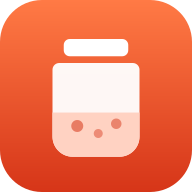
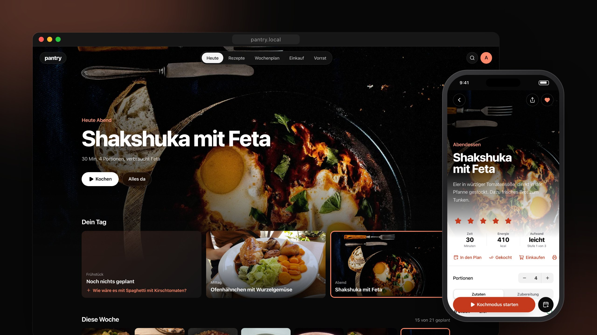
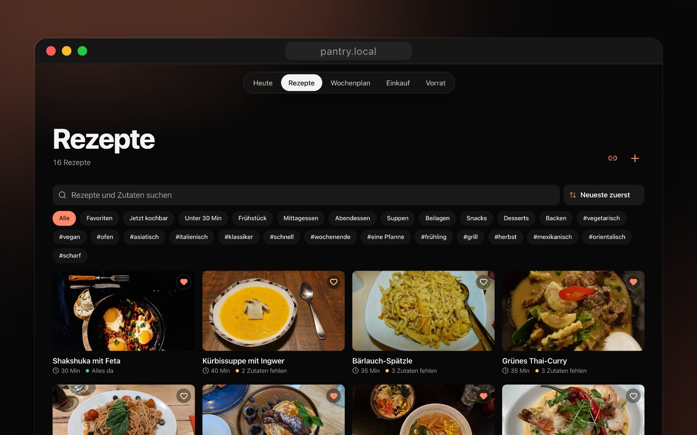
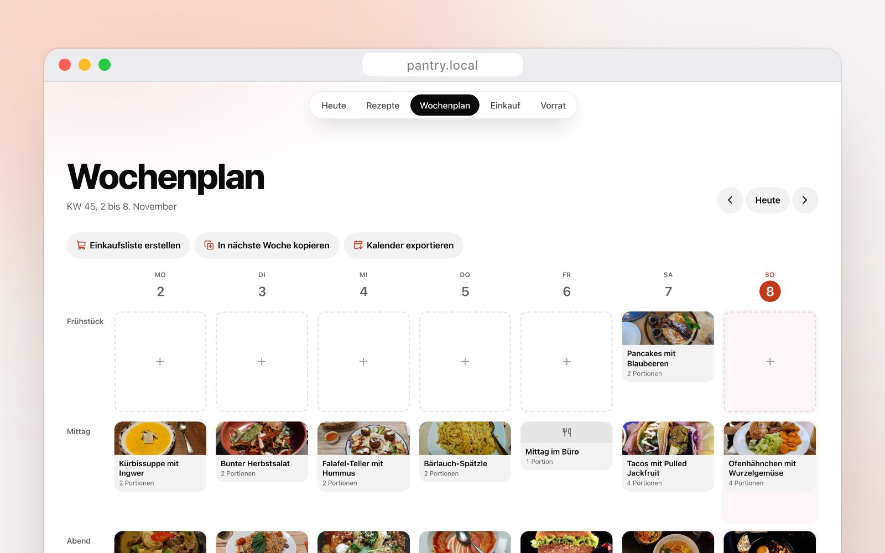
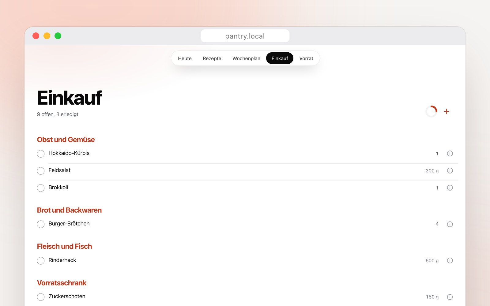
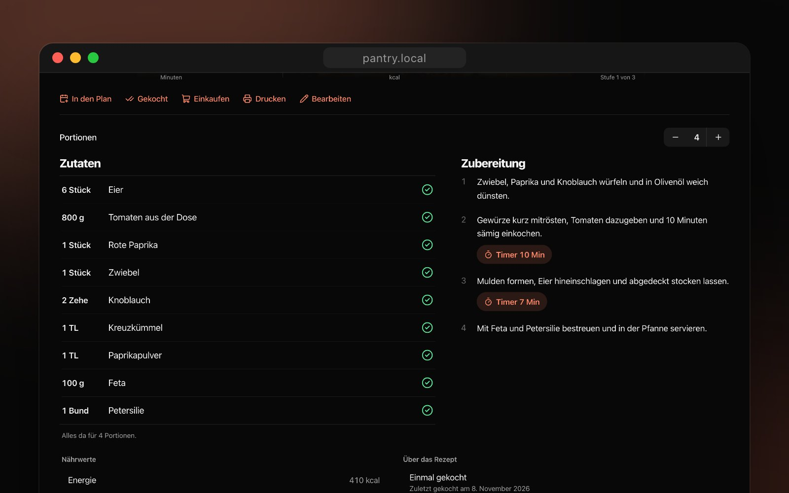
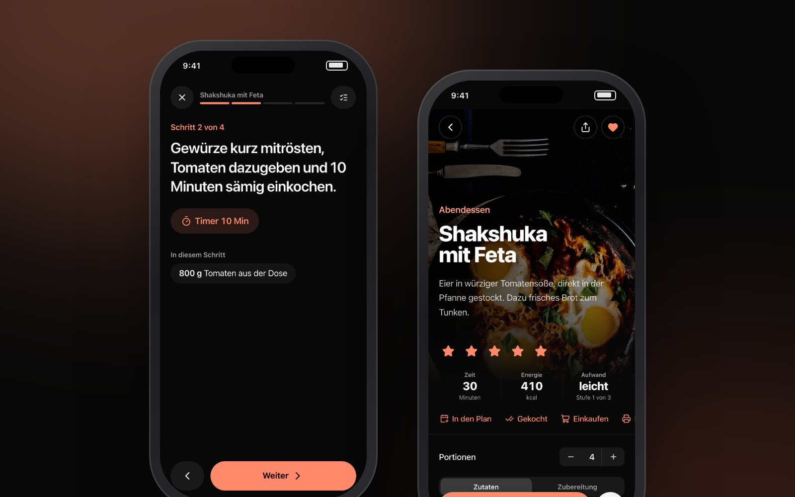
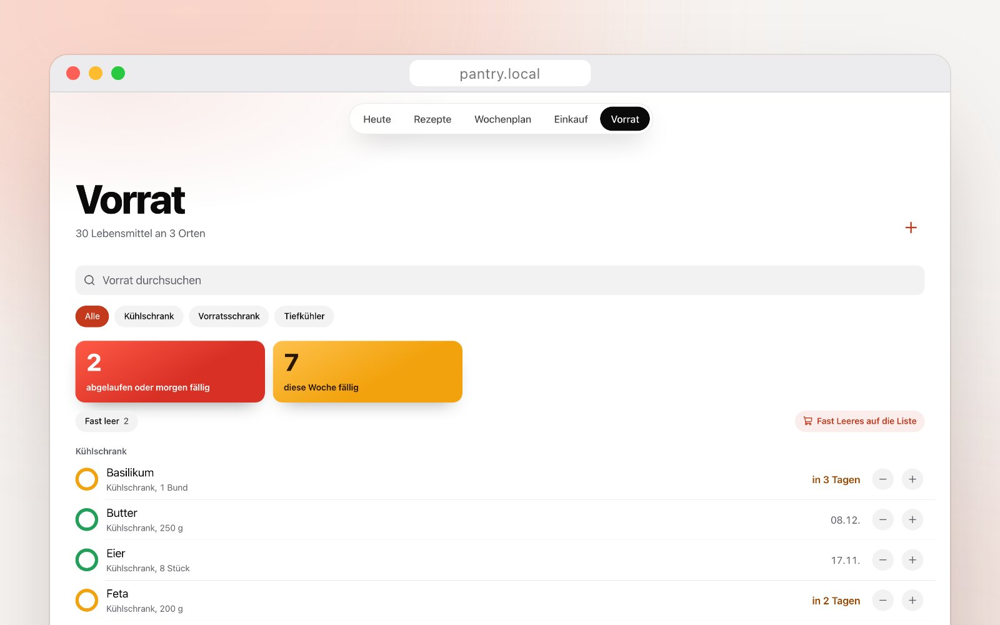
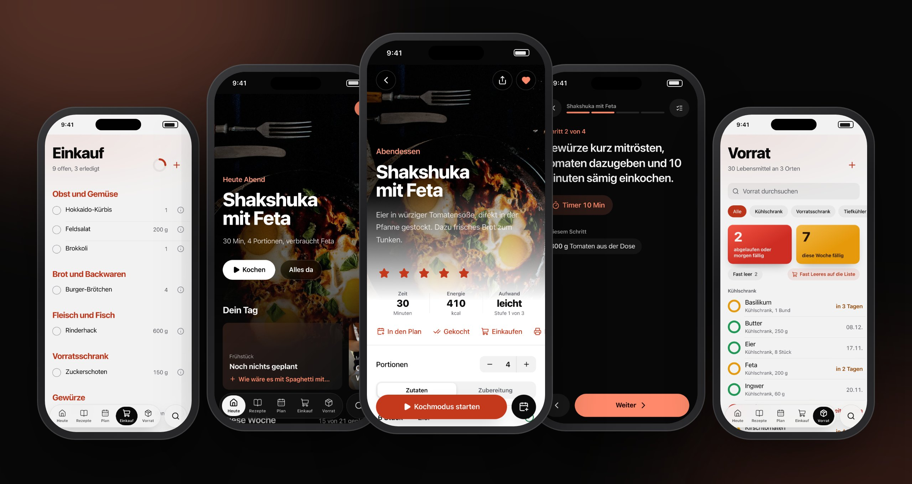
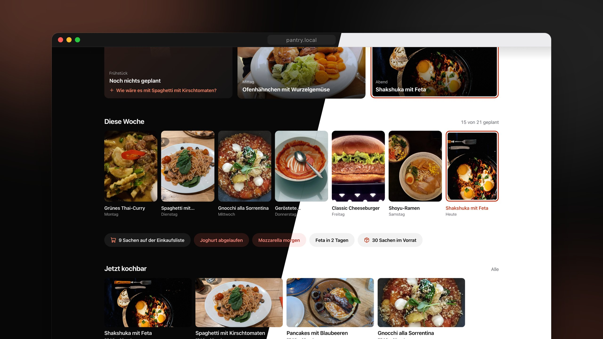

<p align="right"><a href="https://buymeacoffee.com/sgnetz"></a></p>

<p align="center">
  
</p>

<h1 align="center">Pantry</h1>

<p align="center">
  <b>Rezepte, Wochenplan, Einkaufsliste und Vorrat an einem Ort.</b><br>
  Selbst gehostet, für deinen Haushalt. Deine Daten bleiben bei dir.
</p>

<p align="center">
  
  
  
  
  
</p>

<p align="center">
  
</p>

<p align="center">
  <a href="#was-pantry-kann">Funktionen</a> ·
  <a href="#so-sieht-es-aus">Screenshots</a> ·
  <a href="#schnellstart-mit-docker">Schnellstart</a> ·
  <a href="#entwicklung">Entwicklung</a> ·
  <a href="API.md">API</a>
</p>

---

## Was Pantry kann

- **Heute** zeigt dein nächstes Gericht groß im Bild, dazu deinen Tag, die ganze Woche, was du mit deinem Vorrat jetzt kochen kannst und was bald weg muss.
- **Rezepte** mit Fotos, Zutatengruppen, Timern pro Schritt, Bewertungen und Notizen. Import von fast jeder Rezeptseite per Link und aus Paprika.
- **Vorratsabgleich** bei jeder Zutat. Pantry zeigt, ob sie da ist und ob die Menge reicht, und setzt Fehlendes mit einem Tipp auf die Liste.
- **Kochmodus** mit großer Schrift, Timern und einem Bildschirm, der anbleibt. Danach werden die Zutaten auf Wunsch vom Vorrat abgezogen.
- **Wochenplan** mit Ziehen und Ablegen, freien Einträgen wie „Essen gehen“, Woche kopieren und Kalender-Export.
- **Einkaufsliste** nach Gängen im Laden sortiert, mit Schnelleingabe wie „2 kg Kartoffeln“. Gleiche Zutaten werden zusammengefasst und Einheiten umgerechnet. Nach dem Einkauf landet alles im Vorrat.
- **Vorrat** nach Lagerort, mit Füllstand, Ablaufdaten, Mindestmengen und Barcode-Suche über Open Food Facts. Auf Wunsch Erinnerungen per Push.
- **Suche überall** mit ⌘K über Rezepte, Zutaten, Tags und Notizen.
- **App fürs Handy** zum Installieren auf dem Homescreen. Einkaufsliste und Vorrat sind auch ohne Empfang lesbar.
- **REST-API** mit Token für eigene Apps und Integrationen, beschrieben als OpenAPI.
- **Dunkel und hell**, Deutsch, Englisch und Chinesisch.

## So sieht es aus

<table>
  <tr>
    <td width="50%"></td>
    <td width="50%"></td>
  </tr>
  <tr>
    <td><b>Rezepte</b><br>Fotokarten, Filter nach Kategorie und Tag, „Jetzt kochbar“ und unter 30 Minuten.</td>
    <td><b>Wochenplan</b><br>Sieben Tage auf einen Blick. Einkaufsliste für die ganze Woche mit einem Klick.</td>
  </tr>
  <tr>
    <td></td>
    <td></td>
  </tr>
  <tr>
    <td><b>Einkauf</b><br>Sortiert wie dein Laden. Abgehaktes wandert auf Wunsch direkt in den Vorrat.</td>
    <td><b>Rezept</b><br>Jede Zutat mit Vorratsabgleich, Portionen umrechnen, Timer direkt im Schritt.</td>
  </tr>
  <tr>
    <td></td>
    <td></td>
  </tr>
  <tr>
    <td><b>Kochmodus</b><br>Ein Schritt pro Bildschirm, große Schrift, Timer und die Zutaten für genau diesen Schritt.</td>
    <td><b>Vorrat</b><br>Was bald abläuft, steht oben. Fast Leeres kommt mit einem Tipp auf die Liste.</td>
  </tr>
</table>

### Gemacht fürs Handy

<p align="center">
  
</p>

Pantry lässt sich wie eine App auf dem Homescreen installieren. Unten sitzt eine schwebende Leiste, die beim Scrollen kleiner wird.

### Dunkel oder hell

<p align="center">
  
</p>

Pantry startet dunkel, damit die Fotos wirken. Hell lässt sich in den Einstellungen einschalten.

## Schnellstart mit Docker

```bash
mkdir pantry && cd pantry
curl -O https://raw.githubusercontent.com/netz-sg/pantry/master/docker-compose.yml
curl -o .env https://raw.githubusercontent.com/netz-sg/pantry/master/.env.example
```

In `.env` mindestens `AUTH_SECRET` und `APP_URL` setzen. Einen passenden Schlüssel erzeugt

```bash
openssl rand -base64 32
```

Dann starten.

```bash
docker compose up -d
```

Pantry läuft danach auf http://localhost:3000. Beim ersten Aufruf legst du dein Konto an, danach ist die Registrierung geschlossen. Wer die Einrichtung absichern will, setzt zusätzlich `SETUP_TOKEN`.

Mehr zu Updates, Sicherungen und Reverse Proxy steht in [DOCKER.md](DOCKER.md).

## Entwicklung

Voraussetzung ist Node.js 22 oder neuer, empfohlen ist Node 24.

```bash
npm install
cp .env.example .env    # AUTH_SECRET eintragen
npm run dev
```

| Befehl                               | Zweck                                                          |
| ------------------------------------ | -------------------------------------------------------------- |
| `npm run dev`                        | Entwicklungsserver auf Port 3000                               |
| `npm run check`                      | Lint, Typprüfung und Unit-Tests                                |
| `npm run test:e2e`                   | Playwright-Tests gegen einen frischen Produktions-Build        |
| `npm run db:generate`                | Migration aus Änderungen an `src/server/db/schema.ts` erzeugen |
| `npm run reset-password`             | Passwort eines Kontos neu setzen                               |
| `npm run import:legacy -- <alte.db>` | Daten aus Pantry 0.x übernehmen                                |

Wie der Code aufgebaut ist, steht in [docs/architecture.md](docs/architecture.md). Die API ist in [API.md](API.md) beschrieben, alle Änderungen in [CHANGELOG.md](CHANGELOG.md).

## Technik

Next.js 16, React 19, TypeScript, Tailwind CSS 4, SQLite mit Drizzle ORM, Better-Auth, next-intl, Zod, Vitest und Playwright.

## Bildnachweis

Die Screenshots zeigen eine Demo mit erfundenen Beispieldaten. Die Rezeptfotos sind gemeinfrei und stammen von Wikimedia Commons, die Quellen stehen in [docs/screenshots/CREDITS.md](docs/screenshots/CREDITS.md).

## Lizenz

MIT
